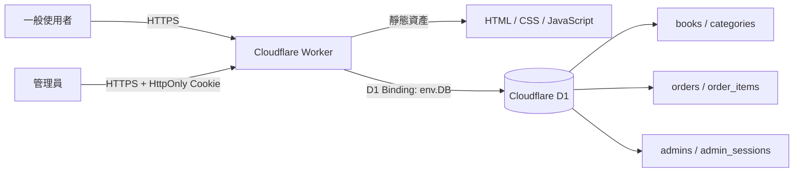

# BookNest 系統架構

## 資料流

1. 瀏覽器向同一個 Cloudflare Worker 網址取得前端靜態檔案。
2. 前端用 `fetch()` 呼叫 `/api/*`。
3. Worker 驗證輸入並透過 `env.DB` 執行參數化 SQL。
4. D1 回傳結果，Worker 統一轉為 JSON。
5. 管理 API 額外檢查 HttpOnly Session Cookie。

## 主要模組

| 模組 | 檔案 | 用途 |
|---|---|---|
| Worker 路由 | `src/index.js` | 分派 API 與靜態資產 |
| 書籍 API | `src/routes/books.js` | 搜尋、分類、排序與單本查詢 |
| 訂單 API | `src/routes/orders.js` | 查價、庫存檢查、原子建立訂單 |
| 管理 API | `src/routes/admin.js` | 登入、書籍 CRUD、訂單紀錄 |
| 驗證 | `src/auth.js` | PBKDF2、Session Cookie 與權限檢查 |
| 前台 | `public/` | 原生 HTML、CSS、JavaScript |

