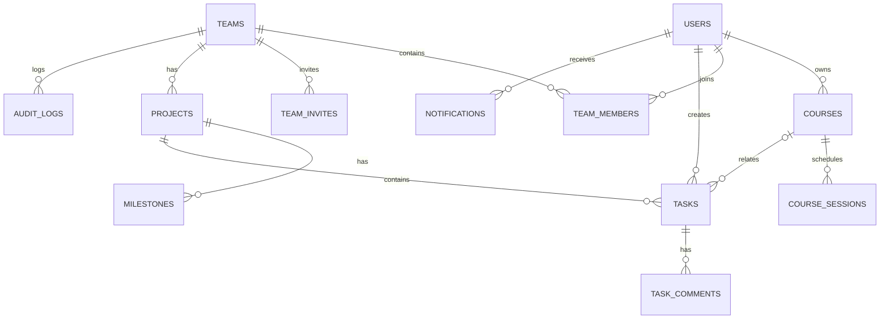

# TaskFlow 智慧課業與專題進度管理系統
## Level 1 → Level 3 完整開發規劃書｜AI 接手開發版

- 文件版本：v1.0（2026-10-30）
- 文件用途：交給下一個 AI 工程代理、開發者或團隊，據此逐階段實作、測試與交付。
- 產品定位：面向學生與小型專題團隊的課業、任務、排程、協作與進度管理平台。
- 目標：先完成可實際使用的 Level 2，再完成可讓不同使用者安全協作的 Level 3；**不含 AI 模型功能、金流與付費訂閱**。
- 重要原則：本文件是**開發規格**，不是已完成的功能清單；原型已有 Level 1 部分能力，其他皆待開發與驗收。

---

# 1. 專案摘要與價值

## 1.1 使用者與痛點
1. 個人學生：課堂作業、考試與專題截止日分散在不同平台，難以掌握優先順序。
2. 專題組長：無法清楚知道誰負責什麼、哪些任務延遲、目前進度到哪裡。
3. 專題組員：需要可視化的工作分配、共同時程、任務更新與討論紀錄。

## 1.2 主要價值主張
- 單一介面管理課程、個人任務、團隊專題與截止日期。
- 專題任務可指派負責人、追蹤狀態、在看板及甘特圖上檢視。
- 根據真實任務資料自動生成進度統計與可下載週報。

## 1.3 商業假設與驗證
- 使用價值：學生願意連續 2–4 週使用，且能更快找出逾期／即將到期任務。
- 潛在商業模式：免費個人版、團隊進階版、校園社團／工作室客製化。
- **不得**把假設當成已有客戶或已驗證的營收。先邀請 3–5 組專題團隊試用，收集留存率、完成任務數、每週活躍使用者與回饋。

# 2. 既有程式盤點與升級策略

## 2.1 目前原型（以隨附程式碼為準）
- `app.py`：Python 標準函式庫 `http.server`、SQLite 任務 CRUD、驗證與統計。
- `index.html`：單頁介面，新增／編輯／刪除／完成任務、搜尋及篩選。
- `test_app.py`：原型測試。
- `README.md`：本機啟動說明。
- 現有 `tasks` 表：`id`, `title`, `category`, `due_date`, `priority`, `notes`, `completed`, `created_at`。
- 既有功能：任務 CRUD、作業／考試／專題分類、高中低優先級、到期篩選、完成率與逾期統計。
- **限制**：無帳號、無權限、無團隊、無課程資料、無行事曆／甘特圖、無部署安全設計。現有 API 為本機單使用者模式，不可直接公開上線。

## 2.2 升級決策
- 建議目標技術：React + TypeScript + Vite + Tailwind CSS；FastAPI + SQLAlchemy 2 + Alembic + Pydantic；SQLite（本機開發），PostgreSQL（多人部署）；pytest；Playwright。
- 既有 `http.server` 程式**保留為 legacy 參考**，不在原本的 `app.py` 中硬塞會員／團隊功能。
- 新建 `frontend/` 與 `backend/`；先完成 Level 1 功能對等，再做 Level 2/3。
- 提供一次性 `scripts/migrate_legacy.py`：讀取舊 `tasks.db`，由使用者指定匯入帳號，轉成新資料庫的個人任務；不修改原資料庫，重跑不重複匯入；先備份並輸出匯入結果。
- 舊資料欄位映射：`title→title`、`category→category`、`due_date→due_date`、`priority→priority`、`notes→description`、`completed→status(done/todo)`；`created_at` 保留。沒有對應欄位使用明確預設值。

# 3. 系統範圍與非目標

## 3.1 必做範圍（Level 3 完成定義）
- 註冊／登入／登出、個人資料、修改密碼。
- 課程管理、每週課表、作業／考試／個人任務。
- 個人月曆與週曆、任務到期站內通知。
- 專題團隊、邀請成員、角色權限、專案與里程碑。
- 團隊任務指派、看板、任務留言、甘特圖。
- 進度統計、PDF 週報、CSV 匯出。
- 響應式桌面／手機介面、基本無障礙、操作紀錄及自動化測試。

## 3.2 明確不做（本階段）
- AI 模型／聊天機器人／付費 AI API。
- Google Classroom／學校校務系統的非官方爬取與自動登入。
- 金流、訂閱、第三方登入、手機原生 App、即時多人協同編輯。
- 內建聊天室、公開社群、跨校排名、教師成績系統。
- 大型檔案儲存：MVP 可先用外部檔案連結，不做上傳與病毒掃描；若需檔案上傳，必須另立安全規格。

# 4. 使用者角色與權限

| 角色 | 範圍 | 權限 |
|---|---|---|
| 訪客 | 全站 | 僅註冊／登入；不可存取任何私人資料 |
| 一般使用者 | 自己的資料 | 課程、課表、個人任務 CRUD；建立團隊；加入團隊 |
| 團隊 Owner | 指定團隊 | 修改團隊、管理成員／角色、專案／里程碑／任務 CRUD、匯出報表、解散團隊 |
| 團隊 Admin | 指定團隊 | 管理專案、成員邀請、團隊任務與報表；不能移除 Owner 或解散團隊 |
| 團隊 Member | 指定團隊 | 檢視團隊內容；新增／編輯自己建立或被指派的任務、留言、更新自己任務狀態 |

權限設計要求：所有資源均在後端驗證 owner_id／team_id membership；前端隱藏按鈕不算權限保護。團隊內的任務不可被非成員讀取。Owner 轉移要獨立流程且不得出現無 Owner 團隊。

# 5. 功能需求（FR）

## Level 1：個人任務管理（先達到新架構功能對等）
- FR-101：任務 CRUD，欄位含標題、說明、類別、優先級、截止日、狀態、建立／更新時間。
- FR-102：搜尋、類別／狀態／優先級篩選，依到期日與優先級排序。
- FR-103：儀表板顯示總數、待辦、完成、逾期、3 日內到期、完成率。
- FR-104：輸入驗證、空資料提示、錯誤回饋與刪除確認。
- FR-105：舊資料遷移與匯入結果檢查。

## Level 2：個人學生平台
- FR-201：Email＋密碼註冊／登入／登出，安全密碼雜湊、登入節流、密碼修改。
- FR-202：個人設定（顯示名稱、時區，預設 Asia/Taipei）。
- FR-203：課程 CRUD：名稱、學期、教師（選填）、地點（選填）、顏色。
- FR-204：課表：課程可有每週多個上課時段，檢查同一使用者課程時段重疊，顯示警告但允許確認保存。
- FR-205：個人任務可關聯課程；作業、考試與個人待辦在同一清單。
- FR-206：月曆／週曆顯示任務截止日期、考試與課程時段；點選可開詳情。
- FR-207：到期提醒：在站內顯示「3 天內到期、已逾期」；避免重複通知；支援已讀。
- FR-208：個人統計：每週完成數、類別分布、逾期數、完成率。

## Level 3：多人專題協作
- FR-301：建立團隊、加入邀請、移除成員、Owner／Admin／Member 角色。
- FR-302：團隊包含一個或多個專案；專案欄位：名稱、說明、開始日、截止日、狀態。
- FR-303：專案里程碑：名稱、日期、狀態；顯示進度與時間線。
- FR-304：團隊任務：指派單一負責人（可空）、建立者、專案、優先級、開始日、截止日、狀態、預估工時（選填）。
- FR-305：看板欄位固定為 `todo`、`in_progress`、`review`、`done`；支援拖曳更改狀態，失敗需復原畫面。
- FR-306：甘特圖依任務起訖日期顯示；任務缺開始日時以截止日為單日事件；不在 MVP 中做複雜相依排程演算法。
- FR-307：任務留言（作者、內容、時間）；作者可刪除自己的留言，Admin／Owner 可管理不當留言。
- FR-308：站內通知：被指派任務、邀請、任務即將到期；每個事件有去重規則。
- FR-309：團隊統計：總任務、各狀態數、完成率、逾期任務、成員完成任務數；不可把完成數直接當績效排名。
- FR-310：PDF 週報：指定專案與日期區間，包含任務統計、已完成、進行中、逾期與里程碑；由伺服器產生。
- FR-311：CSV 匯出團隊任務，欄位與權限同畫面一致。
- FR-312：重要操作留存稽核紀錄：成員角色異動、任務刪除、團隊刪除、專案刪除。

# 6. 使用流程（User Stories）

1. 學生註冊 → 登入 → 建立課程 → 輸入課表 → 新增作業 → 行事曆看到截止日 → 完成任務。
2. 組長建立團隊 → 建立專案 → 產生邀請碼／連結 → 組員加入 → 指派任務 → 看板更新 → 查看甘特圖 → 匯出週報。
3. 組員收到任務指派 → 查看任務 → 留言回報 → 移至待審核 → 組長確認完成。
4. 非團隊成員直接猜測 API ID → API 必須回傳 404 或 403，且不得洩漏資料。

# 7. 頁面／路由規格

| 路由 | 頁面 | 核心內容 |
|---|---|---|
| `/login`, `/register` | 登入／註冊 | 表單、驗證、錯誤訊息 |
| `/dashboard` | 個人儀表板 | 統計卡片、近期任務、通知 |
| `/tasks` | 個人任務 | 清單、搜尋、篩選、CRUD |
| `/calendar` | 行事曆 | 月／週檢視、任務與課程 |
| `/courses` | 課程與課表 | 課程 CRUD、每週課表 |
| `/teams` | 我的團隊 | 團隊清單、建立、邀請 |
| `/teams/:teamId/settings` | 團隊管理 | 成員、角色、邀請 |
| `/teams/:teamId/projects` | 專案清單 | 專案 CRUD |
| `/projects/:projectId/board` | 專題看板 | 狀態欄、任務卡、指派 |
| `/projects/:projectId/gantt` | 甘特圖 | 任務起訖與里程碑 |
| `/projects/:projectId/reports` | 專題報表 | 統計、PDF／CSV 匯出 |
| `/notifications` | 通知中心 | 未讀／已讀、連結 |
| `/settings` | 個人設定 | 名稱、密碼、時區 |

介面原則：左側導覽列、手機可收合；任務新增／編輯用抽屜或對話框；空狀態要有清楚 CTA；操作有載入、成功、失敗狀態；不以顏色作為唯一狀態區別。

# 8. 資料庫設計（關聯與約束）

## 8.1 核心資料表

| 表 | 主要欄位 | 約束／說明 |
|---|---|---|
| `users` | `id UUID PK`, `email UNIQUE`, `password_hash`, `display_name`, `timezone`, `created_at` | email 正規化；密碼不可明文 |
| `courses` | `id`, `user_id FK`, `name`, `semester`, `teacher`, `location`, `color` | 個人課程 |
| `course_sessions` | `id`, `course_id FK`, `weekday`, `start_time`, `end_time` | weekday 1–7，end > start |
| `teams` | `id`, `name`, `description`, `created_by FK`, `created_at` | 一個團隊有多位成員 |
| `team_members` | `team_id FK`, `user_id FK`, `role`, `joined_at` | `(team_id,user_id)` UNIQUE；role 限 owner/admin/member |
| `team_invites` | `id`, `team_id FK`, `token_hash UNIQUE`, `expires_at`, `max_uses`, `used_count`, `created_by` | 不儲存明文邀請 token |
| `projects` | `id`, `team_id FK`, `name`, `description`, `start_date`, `due_date`, `status` | 專案必屬於團隊 |
| `milestones` | `id`, `project_id FK`, `title`, `due_date`, `status` | 專案里程碑 |
| `tasks` | `id`, `owner_id FK NULL`, `project_id FK NULL`, `course_id FK NULL`, `created_by FK`, `assignee_id FK NULL`, `title`, `description`, `category`, `priority`, `status`, `start_date`, `due_date`, `estimated_hours`, `created_at`, `updated_at`, `completed_at` | 個人任務 `owner_id` 非空且 `project_id` 空；團隊任務反之；關聯課程僅個人任務可用 |
| `task_comments` | `id`, `task_id FK`, `author_id FK`, `body`, `created_at` | 留言需權限檢查 |
| `notifications` | `id`, `user_id FK`, `kind`, `entity_type`, `entity_id`, `dedupe_key`, `read_at`, `created_at` | `(user_id,dedupe_key)` UNIQUE |
| `audit_logs` | `id`, `actor_id FK`, `team_id FK NULL`, `action`, `entity_type`, `entity_id`, `created_at` | 僅記必要事件；避免儲存敏感欄位 |

所有表的 `id` 建議 UUID（SQLite 以 TEXT 存）；所有時間戳記以 UTC 儲存、UI 依使用者時區顯示；日期欄位使用 ISO `YYYY-MM-DD`，時間使用 ISO 8601。外鍵開啟且建立索引。

## 8.2 Mermaid ER 概觀



## 8.3 資料完整性規則
- 個人任務與團隊任務互斥，後端以驗證與 DB CHECK 雙重保護。
- `assignee_id` 必須是該任務專案所屬團隊的有效成員；移除成員時將其未完成任務改為未指派，並寫 audit log。
- `course_id` 必須屬於 `owner_id`，禁止跨帳號關聯。
- `start_date <= due_date`（若 start_date 存在）；`completed_at` 與 `status=done` 一致。
- 刪除專案／團隊採明確二次確認，關聯資料刪除策略須以 migration 和測試定義；不得靜默刪除其他使用者資料。
- 任務完成率 = done / 全部任務 × 100%；空集合顯示 0%，並標示「尚無任務」。

# 9. REST API 規格（v1）

共同規範：前綴 `/api/v1`；JSON；所有 list API 支援 `limit`（預設 20、上限 100）及 `offset`；統一錯誤格式 `{"error":{"code":"...","message":"...","details":{}}}`；需要登入者以 HttpOnly Secure SameSite Cookie Session 驗證並對變更操作加 CSRF 保護；正式環境必須 HTTPS。

## 9.1 身分與個人資料

| Method | Endpoint | 說明 |
|---|---|---|
| POST | `/auth/register` | 註冊，驗證 email／密碼 |
| POST | `/auth/login` | 登入、建立 session |
| POST | `/auth/logout` | 登出、撤銷 session |
| GET | `/auth/me` | 取得目前使用者 |
| PATCH | `/users/me` | 修改顯示名稱／時區 |
| POST | `/users/me/change-password` | 修改密碼 |

## 9.2 個人管理

| Method | Endpoint | 說明 |
|---|---|---|
| GET/POST | `/tasks` | 列表／新增個人任務（不含團隊任務） |
| GET/PATCH/DELETE | `/tasks/{task_id}` | 個人任務詳情／修改／刪除 |
| GET/POST | `/courses` | 課程列表／新增 |
| GET/PATCH/DELETE | `/courses/{course_id}` | 課程詳情／修改／刪除 |
| GET/POST | `/courses/{course_id}/sessions` | 課程時段列表／新增 |
| DELETE | `/courses/{course_id}/sessions/{session_id}` | 刪除課程時段 |
| GET | `/calendar/events?from=...&to=...` | 個人課表＋任務事件（日期區間上限 93 天） |
| GET | `/dashboard/summary` | 個人儀表板統計 |
| GET | `/notifications` | 通知列表 |
| PATCH | `/notifications/{notification_id}/read` | 標記已讀 |

## 9.3 團隊／專案

| Method | Endpoint | 說明 |
|---|---|---|
| GET/POST | `/teams` | 我的團隊／建立 |
| GET/PATCH/DELETE | `/teams/{team_id}` | 團隊詳情／更新／刪除（Owner） |
| GET | `/teams/{team_id}/members` | 成員列表 |
| PATCH/DELETE | `/teams/{team_id}/members/{user_id}` | 改角色／移除成員（權限限制） |
| POST | `/teams/{team_id}/invites` | 建立限時邀請（Owner/Admin） |
| POST | `/team-invites/accept` | 使用邀請 token 加入團隊 |
| GET/POST | `/teams/{team_id}/projects` | 專案列表／新增 |
| GET/PATCH/DELETE | `/projects/{project_id}` | 專案詳情／更新／刪除 |
| GET/POST | `/projects/{project_id}/milestones` | 里程碑列表／新增 |
| PATCH/DELETE | `/milestones/{milestone_id}` | 更新／刪除里程碑 |
| GET/POST | `/projects/{project_id}/tasks` | 專案任務列表／新增 |
| GET/PATCH/DELETE | `/project-tasks/{task_id}` | 團隊任務詳情／修改／刪除 |
| PATCH | `/project-tasks/{task_id}/status` | 看板拖曳狀態更新 |
| GET/POST | `/project-tasks/{task_id}/comments` | 留言列表／新增 |
| DELETE | `/task-comments/{comment_id}` | 刪除留言 |
| GET | `/projects/{project_id}/summary` | 專案統計 |
| GET | `/projects/{project_id}/reports/weekly.pdf?from=...&to=...` | PDF 週報 |
| GET | `/projects/{project_id}/tasks.csv` | CSV 匯出 |

## 9.4 API 範例

新增個人任務：
```http
POST /api/v1/tasks
Content-Type: application/json
X-CSRF-Token: <csrf-token>
```
```json
{"title":"資料庫作業第 3 章","category":"assignment","priority":"high","status":"todo","due_date":"2026-11-08","course_id":null,"description":"完成 SQL 練習"}
```
成功：`201 Created`，回傳 `{"data":{"id":"<uuid>","title":"資料庫作業第 3 章", "status":"todo", "due_date":"2026-11-08"}}`（實作時回傳完整 Task schema）。

常見 HTTP 狀態：`200` 查詢／更新、`201` 建立、`204` 刪除、`400` 格式錯誤、`401` 未登入、`403` 無權限、`404` 不存在或不可見、`409` 衝突、`422` 欄位驗證錯誤、`429` 速率限制。

## 9.5 契約與文件
- FastAPI 自動產生 `/docs` OpenAPI；正式部署可依需要關閉公開文件。
- Pydantic schema 與前端 TypeScript 型別必須對齊；提交 API 契約測試。
- 不要把伺服器例外堆疊顯示給使用者。

# 10. 自動化邏輯與計算定義

- 到期：未完成且 `due_date < 使用者當地今天` 為逾期；`今天 <= due_date <= 今天+3天` 為近期到期。
- 站內通知：每次登入／載入儀表板時可觸發輕量檢查；正式部署改背景排程。以 `user_id + task_id + reminder_type + due_date` 組成去重鍵。
- 看板狀態：`todo → in_progress → review → done`；允許有權限者往回移動，完成時間同步更新。
- 甘特圖：以任務 `start_date` 和 `due_date` 呈現；里程碑為單點；日期跨時區以日期欄位為準。
- 週報區間：預設最近 7 天；「本週完成」按 `completed_at` 落在區間內；當前狀態與當週完成數應清楚區分。
- 統計：按專案、日期範圍與成員篩選，查詢必須遵守團隊權限。

# 11. 安全、隱私與非功能需求（NFR）

- NFR-01：密碼採 Argon2id（或經審核之同級安全雜湊），不得儲存明文或回傳 hash。
- NFR-02：Cookie session：HttpOnly、Secure（HTTPS）、SameSite=Lax/Strict；所有變更請求有 CSRF 防護；登出立即失效。
- NFR-03：每個 endpoint 執行伺服器端授權；驗證跨團隊／跨使用者資料隔離（IDOR）。
- NFR-04：登入／邀請／匯出設置合理速率限制；對標題、留言、URL 等做輸入驗證與輸出轉義，避免 XSS。
- NFR-05：僅收集必要資料；明確提供資料刪除／匯出流程；避免公開真實課表、姓名或個人任務。
- NFR-06：API 列表分頁、DB 索引、避免 N+1；以 20 人／團隊、1000 任務／專案作為初步測試資料量，不代表正式容量保證。
- NFR-07：手機寬度 375px 可操作；鍵盤可導航、表單有標籤、錯誤可辨識、顏色對比足夠。
- NFR-08：本機 `docker compose up --build` 可啟動；`.env.example` 列出環境變數；秘密不可提交版本控制。
- NFR-09：資料庫遷移使用 Alembic，提供備份、還原說明與健康檢查端點。
- NFR-10：開發及測試使用虛構資料；正式上線前完成安全檢查、隱私告知與部署審核。

# 12. 專案資料夾規劃

```text
TaskFlow/
├── README.md
├── .env.example
├── docker-compose.yml
├── docs/
│   ├── requirements.md
│   ├── api-contract.md
│   ├── database.md
│   ├── decisions.md
│   └── progress.md
├── legacy/
│   ├── app.py
│   ├── index.html
│   ├── test_app.py
│   └── README.md
├── backend/
│   ├── pyproject.toml
│   ├── alembic.ini
│   ├── alembic/versions/
│   ├── app/
│   │   ├── main.py
│   │   ├── core/{config,security,permissions}.py
│   │   ├── db/{base,session}.py
│   │   ├── models/
│   │   ├── schemas/
│   │   ├── api/v1/
│   │   ├── services/
│   │   └── reports/
│   ├── scripts/migrate_legacy.py
│   └── tests/
├── frontend/
│   ├── package.json
│   ├── src/
│   │   ├── app/
│   │   ├── pages/
│   │   ├── components/
│   │   ├── features/{auth,tasks,courses,calendar,teams,projects,reports}/
│   │   ├── services/api.ts
│   │   └── types/
│   └── tests/
└── e2e/
    └── tests/
```

# 13. 開發里程碑與工作分解（必須依序）

| 階段 | 預估時間（AI 協作、單人每天 2–4 小時） | 交付內容 | 通過條件 |
|---|---|---|---|
| P0 盤點與基礎建置 | 2–4 天 | Git、README、環境、DB migration、CI、原型封存 | 一鍵啟動，基本測試通過 |
| P1 Level 1 遷移 | 4–7 天 | 新架構任務 CRUD、搜尋、統計、舊資料匯入 | 功能與原型對等，匯入前後數量一致 |
| P2 Level 2 帳號與課程 | 1–2 週 | Auth、課程、課表、個人資料隔離 | 兩個帳號無法互看資料 |
| P3 Level 2 行事曆與提醒 | 4–7 天 | 月／週曆、站內提醒、個人分析 | 日期／時區邊界測試通過 |
| P4 Level 3 團隊與專案 | 1–2 週 | 團隊、邀請、角色、專案、里程碑 | 角色權限測試通過 |
| P5 Level 3 看板與甘特圖 | 1–2 週 | 指派、看板、留言、甘特圖 | 狀態更新一致，無跨團隊洩漏 |
| P6 Level 3 報表與通知 | 4–7 天 | 週報 PDF、CSV、團隊統計、通知 | 下載內容正確，無權限無法下載 |
| P7 整合、部署與試用 | 1–2 週 | E2E、壓測、備份、部署文件、試用回饋 | 完整使用流程可重現 |

總計約 7–12 週，僅為粗略估計；功能範圍與除錯狀況會影響進度。

# 14. 測試計畫與驗收標準

## 14.1 必備自動化測試
- 單元：任務驗證、到期計算、完成率、通知去重、課表衝突。
- API 整合：註冊／登入／登出、任務 CRUD、課程、邀請、權限、看板更新、匯出。
- 權限：未登入 401；A 使用者不得讀 B 任務；非成員不得讀團隊；Member 不得升權；Owner 不得被移除成無 Owner。
- 資料：SQLite 開啟 FK、日期合法、狀態合法、重複邀請 token 不可重複使用超過上限。
- 前端：表單驗證、載入／空／錯誤狀態、看板更新失敗回滾、手機版導覽。
- E2E：從建立兩位使用者、邀請入團、指派任務、更新看板、生成週報到登出。

## 14.2 完成定義（Definition of Done）
- 所有 Level 1–3 必做功能可在本機操作，無假按鈕、無純靜態假資料替代實際 API。
- 所有私人資料都由後端授權保護；核心 API 測試通過。
- 新人依 README 可在乾淨環境啟動、建立資料庫、執行測試。
- OpenAPI 與資料庫 migration 版本一致；前後端型別與欄位一致。
- PDF／CSV 可正確下載，含中文內容且不亂碼。
- `docs/progress.md` 記錄完成、未完成、已知問題、下一步及測試結果。

## 14.3 驗收情境（最少 8 項）
1. 使用者 A 註冊、登入、新增作業，重新整理後資料仍在。
2. A 新增兩門課與課表，行事曆顯示正確。
3. A 設定明日到期作業，儀表板顯示近期到期。
4. 使用者 B 登入，不可查閱 A 的課程或個人任務。
5. A 建立團隊並邀請 B；B 接受後可看見團隊專案。
6. A 指派 B 一個任務，B 可以移動至進行中並留言。
7. C 未加入團隊，直接使用專案 ID 請求時不能取得資料。
8. A 看到甘特圖、完成率，匯出中文 PDF 週報與 CSV。
9. 移除 B 後，B 不再能查看團隊內容，未完成指派任務轉為未指派。
10. 對同一邀請重複使用／超過有效期限，API 回傳可理解的錯誤。

# 15. UI／UX 與視覺設計

- 品牌：TaskFlow；風格乾淨、簡潔、淺色優先，深色模式可延後。
- 色彩：主色藍／靛色，狀態色依用途使用；勿只靠顏色傳達狀態。
- 桌面：側邊欄＋頂部搜尋／通知＋主內容；手機：側邊欄改抽屜。
- 核心組件：統計卡、任務卡、任務表單、日期選擇、課表、月曆、看板、甘特圖、通知列表、報表表格。
- 每頁都要有 Loading、Empty、Error、Success 四種狀態。
- 預設繁體中文；時間預設 Asia/Taipei；日期顯示 `YYYY/MM/DD`，API 保持 ISO 格式。

# 16. 資料來源、開發環境與成本

- 原型資料：本機舊 `tasks.db`（若存在）；**不得假設壓縮檔中已有使用者資料庫**。
- 新資料：使用者自行建立課程、任務、團隊與專案；測試時用 seed 腳本產生虛構資料。
- 不依賴外部資料 API 或付費 AI API。
- 開發環境：Python 3.11+、Node.js LTS、SQLite、Git；建議 Docker 作為一致環境。
- 正式部署：PostgreSQL、HTTPS、受管理的 session secret、日誌與備份；主機費用依選用服務而定。

# 17. AI 接手實作規則（必讀）

1. **先讀本文件、原型 README、`app.py`、`index.html`、`test_app.py`，再開始改程式。**
2. 不要一次生成整套大型系統；按 P0 → P7 小步實作，每階段完成可執行功能、測試、文件後再進下一階段。
3. 不得刪除舊程式或直接覆蓋 `tasks.db`；先封存、備份，再遷移。
4. 優先實作真實後端與資料庫，不得以 localStorage 或假資料假裝完成多人協作。
5. 每個 API 都必須有 schema 驗證、權限檢查與一致錯誤回應。
6. 若需求有歧義，先採用本文件列出的預設決策並記錄 `docs/decisions.md`；只有重大衝突才向使用者提問。
7. 每階段回報：完成檔案、執行命令、測試結果、已知限制、下一階段；不得聲稱未執行的測試已通過。
8. 交付可重現的啟動方式、`.env.example`、migration、seed、測試與 README。
9. 優先完成使用價值與安全性，不提前加入 AI、金流或非必要外部整合。

# 18. 可以直接貼給下一個 AI 的啟動提示詞

> 你是 TaskFlow 專案的資深全端工程師與技術負責人。請完整閱讀隨附的 `TaskFlow_Level3_AI_開發規劃書.md` 與 `legacy/` 原型程式。目標是依 P0→P7 完成 Level 1～Level 3，採 React + TypeScript + Vite + Tailwind CSS、FastAPI + SQLAlchemy + Alembic、SQLite（開發）／PostgreSQL（部署）。不得刪除原型、不得假裝功能完成、不得以靜態資料取代真實 API。現在**只開始 P0**：先檢查現有程式、建立新專案骨架、環境設定、資料庫 migration、健康檢查、基本測試、README 與 `docs/progress.md`。請提供實際修改的檔案、啟動方式、測試命令與結果；完成後等待我確認再進 P1。若有設計決策，記錄在 `docs/decisions.md`。

# 19. 交付清單

- [ ] 可啟動的前端、後端與資料庫
- [ ] Alembic migrations 與測試資料 seed
- [ ] 舊版任務資料安全匯入腳本
- [ ] 註冊、登入與安全權限
- [ ] 個人任務、課程、課表、行事曆、提醒
- [ ] 團隊、專案、里程碑、看板、甘特圖、留言
- [ ] 統計、PDF 週報與 CSV 匯出
- [ ] 單元、API、權限、E2E 測試
- [ ] OpenAPI、README、部署／備份／還原說明
- [ ] `docs/progress.md` 與 `docs/decisions.md`

---

**交接說明：** 此規格書可直接用於 AI 分階段開發。原型僅為 Level 1 的單人本機程式；Level 2 與 Level 3 需要依本規格新增，不得視為已完成。
